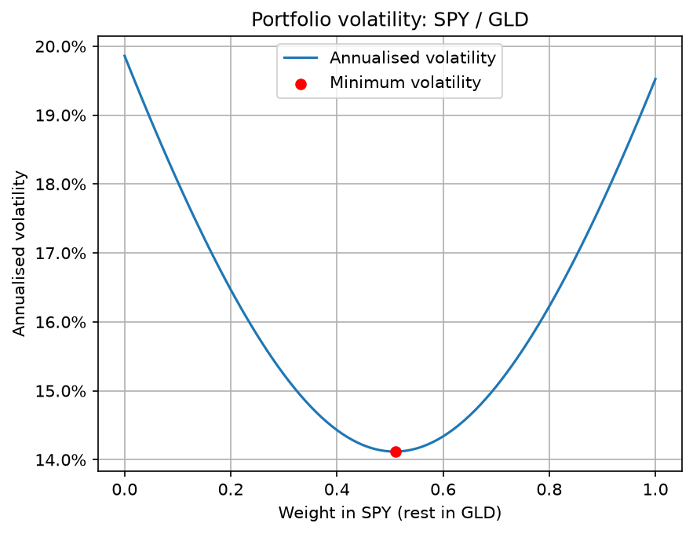

# Portfolio Risk Optimizer

Can combining two assets reduce risk compared with holding either one alone?
This project finds the **minimum-volatility allocation** between two assets
(by default SPY, US stocks, and GLD, gold) using historical daily returns,
and shows how portfolio volatility changes with the allocation.

Built by Dan Craciun and Matei Baciu.



## Method

1. **Data.** Daily adjusted closing prices from Yahoo Finance (`yfinance`,
   `auto_adjust=True`, so dividends and splits are accounted for).
2. **Returns.** Simple daily returns, close to close:
   r_t = P_t / P_{t-1} − 1. Dates are aligned across both assets and
   missing values dropped.
3. **Portfolio variance.** With weight w in asset 1 and 1 − w in asset 2:

   σ_p² = w²σ₁² + (1 − w)²σ₂² + 2w(1 − w)·Cov(1, 2)

   Daily volatility is annualised by multiplying by √252 (trading days per year).
4. **Optimisation.** Grid search over w = 0.00, 0.01, …, 1.00, long-only
   (no short selling, no leverage).

## Results (SPY / GLD)

| Window | Min-volatility allocation | Annualised volatility |
|---|---|---|
| Calendar 2025 | 51% SPY / 49% GLD | 14.12% |
| Oct 2025 – Oct 2026 | 95% SPY / 5% GLD | 12.65% |

In 2025, gold acted as a diversifier and the optimum was close to 50/50.
Over the most recent year, gold was the more volatile asset and the optimum
moved almost entirely to SPY. Longer windows (3 and 5 years) move back
towards a balanced mix.

**The optimal weight is highly sensitive to the estimation window.**

## Limitations

- **Window sensitivity:** see above. A weight that was optimal historically
  is not guaranteed to be optimal in the future.
- **Constant volatility assumption:** annualising with √252 assumes daily
  returns are independent with constant variance. In reality volatility
  clusters (e.g. March 2020), so the figures are averages over the window.
- **Risk only:** the optimisation minimises volatility and ignores returns.
- **1% grid:** the optimum is found to the nearest percentage point;
  daily rebalancing and no transaction costs are assumed.

## Project structure

| File | Purpose |
|---|---|
| `data_loader.py` | Downloads prices and computes daily returns |
| `portfolio_math.py` | Portfolio volatility, volatility curve, optimiser |
| `analysis.py` | Command-line analysis: prints the result, saves the chart |
| `app.py` | Streamlit web interface for any pair of tickers |

## How to run

```bash
python -m venv venv
source venv/bin/activate
python -m pip install -r requirements.txt

python analysis.py              # SPY/GLD for 2025, saves risk_curve.png
python -m streamlit run app.py  # interactive web app
```